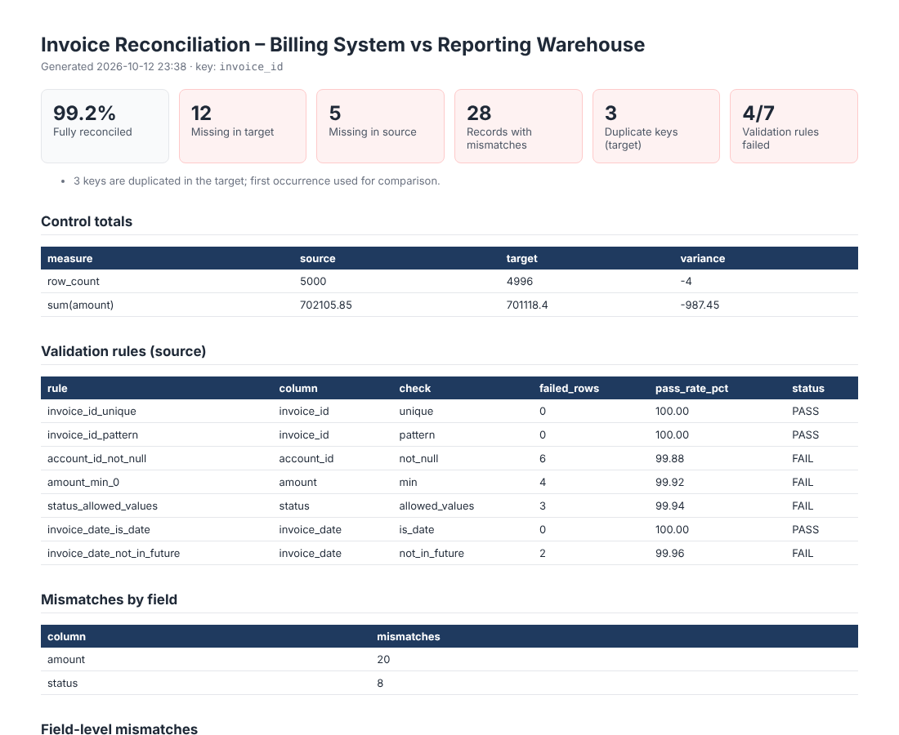

# Data Reconciliation & Validation Toolkit


A config-driven Python tool that answers the question every reporting team gets asked:
**"Why don't the numbers in the dashboard match the source system?"**

It compares two extracts record by record, validates the source against business rules, and produces an
audit-ready Excel workbook plus an HTML summary that traces every discrepancy back to a specific record.

> **Data note:** the sample data is synthetic, generated by `sample_data/generate_sample.py` with known,
> deliberately injected issues. The test suite checks that the toolkit finds exactly those issues.



## What it checks

| Check | How |
|---|---|
| **Completeness** | Records missing from the target, and records in the target with no source |
| **Duplicates** | Keys loaded more than once, on either side |
| **Field-level accuracy** | Every compared column on every matched record, with a numeric tolerance (e.g. ignore ±$0.01 rounding) and optional text normalisation (case / whitespace) |
| **Control totals** | Row counts and summed measures on both sides, with variance |
| **Data quality rules** | `not_null`, `unique`, `unique_together` (composite keys), `min`, `max`, `between`, `max_length`, `allowed_values`, `pattern` (regex), `is_date`, `not_in_future` |

## Sample run

```
$ python -m recon --config config/billing_vs_warehouse.yaml --today 2026-10-01

                        metric value
                   Source rows  5000
                   Target rows  4996
      Duplicate keys in target     3
             Missing in target    12
             Missing in source     5
 Records with field mismatches    28
Fully reconciled (% of source)  99.2

    measure     source    target variance
  row_count       5000      4996       -4
sum(amount)  702105.85  701118.4  -987.45
```

The −$987.45 variance in the control totals is explained by the record-level detail:

| Cause | Impact on target total |
|---|---|
| 12 invoices never loaded to the warehouse | −$1,548.12 |
| 5 invoices that exist only in the warehouse | +$150.00 |
| 3 duplicate loads | +$466.19 |
| 20 amount differences | −$55.64 |
| 30 sub-cent rounding differences (within tolerance, not flagged) | +$0.12 |
| **Total** | **−$987.45** |

The rounding noise and 15 case/whitespace-only differences are correctly **not** flagged as mismatches.

The Excel report has one tab per finding (Summary, Control Totals, Validation, Validation Failures,
Field Mismatches, Missing in Target, Missing in Source, Duplicates), with failing rules highlighted.

## Configure your own reconciliation

Everything is driven by a YAML file, so a new reconciliation needs no code changes:

```yaml
source: {name: Billing system,      path: sample_data/billing_system.csv}
target: {name: Reporting warehouse, path: sample_data/reporting_warehouse.csv}

reconcile:
  key: invoice_id
  compare: [account_id, invoice_date, amount, status, region]
  numeric_tolerance: 0.01
  normalise_text: true
  sum_columns: [amount]

validation:
  - {column: account_id, rule: not_null}
  - {column: amount, rule: min, value: 0}
  - {column: status, rule: allowed_values, value: [Paid, Open, Overdue, Void]}
  - {column: invoice_date, rule: not_in_future}
```

Every option and rule is documented in [`docs/config_reference.md`](docs/config_reference.md).

Use `--fail-on-issues` to return exit code 1 when anything is found, so the check can gate a scheduled job or CI pipeline.

## Second example: customer master data

`config/crm_vs_billing_customers.yaml` reconciles CRM customer records against the billing system with **no code
changes**, just a new config. It finds the 4 accounts that were never set up in billing, plan and status changes that
did not sync, and CRM data gaps (missing emails, negative credit limits).

```bash
python sample_data/generate_customer_sample.py
python -m recon --config config/crm_vs_billing_customers.yaml
```

## Use it from Python

```python
import pandas as pd
from recon import reconcile, validate

result = reconcile(src_df, tgt_df, key="invoice_id", compare=["amount", "status"], numeric_tolerance=0.01)
print(result.summary())
result.mismatches          # key, column, source_value, target_value, difference
```

## Project structure

```
data-reconciliation-toolkit/
├── recon/
│   ├── reconcile.py     # record matching, mismatches, control totals
│   ├── validate.py      # rule engine
│   ├── report.py        # Excel + HTML output
│   └── cli.py           # python -m recon
├── config/billing_vs_warehouse.yaml
├── sample_data/         # synthetic extracts + answer key
├── tests/test_recon.py  # 14 tests, incl. checks against the answer key
└── reports/             # generated output
```

## How to run

```bash
python -m venv .venv && source .venv/bin/activate   # Windows: .venv\Scripts\activate
pip install -r requirements.txt
python sample_data/generate_sample.py                # optional: regenerate sample data
python -m recon --config config/billing_vs_warehouse.yaml --today 2026-10-01
pytest
```

## Tools
Python · Pandas · NumPy · openpyxl · PyYAML · pytest
